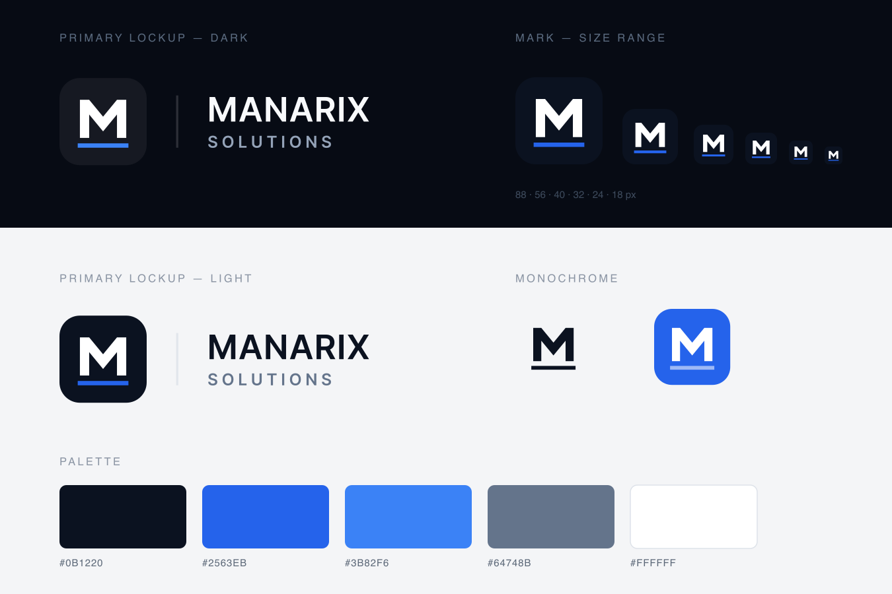

# Brand & design system

Visual identity for Manarix Solutions on the web.

---

## Logo assets



| File                              | Usage                                         |
| --------------------------------- | --------------------------------------------- |
| `public/logo-mark.svg`            | Icon mark only (favicon source, app icon)     |
| `public/logo-mark-mono.svg`       | Single-colour mark, inherits `currentColor`   |
| `public/logo-full.svg`            | Full lockup on light backgrounds              |
| `public/logo-full-dark.svg`       | Full lockup on dark backgrounds (decks, hero) |
| `public/logo-full.png`            | Raster lockup on navy (1040×380)              |
| `public/logo-full-light.png`      | Raster lockup on white (1040×380)             |
| `public/logo-mark.png`            | Raster mark (512×512)                         |
| `public/apple-touch-icon.png`     | iOS home screen icon (180×180, full bleed)    |
| `src/components/ui/logo-mark.tsx` | SVG mark component                            |
| `src/components/ui/logo.tsx`      | Interactive logo in navbar & footer           |
| `docs/brand/logo-sheet.svg`       | Brand sheet — lockups, size range, palette    |

### Mark design

- **Monogram:** chiselled solid “M” — two pillars converging on a pointed apex (structure, convergence)
- **Construction:** 32×32 grid, stems and diagonals both 3.4 units for even optical weight
- **Ledger rule:** square-capped indigo baseline spanning the exact width of the M (reconciliation, foundation)
- **Container:** navy `#0B1220`, `rx=7.5` on light surfaces; `rgba(255,255,255,0.06)` tile on dark surfaces
- **Discipline:** two colours only, flat fills, no gradients, no floating ornament — legible down to 18 px

### Wordmark

- **MANARIX** — Inter Tight 600, letter-spacing `0.055em`, all caps
- **SOLUTIONS** — Inter Tight 600, letter-spacing `0.26em`, muted, all caps
- Separated from the mark by a hairline vertical rule

In the exported SVG lockups the wordmark is **converted to outlines**, so the files render
identically without Inter Tight installed. Regenerate them after any wordmark change:

```bash
pip install fonttools brotli
npm run build                  # ensures the Inter Tight subset is on disk
python3 scripts/build-logo.py  # rewrites public/logo-full{,-dark}.svg
```

---

### In-app logo component

```tsx
import { Logo } from "@/components/ui/logo";
import { LogoMark } from "@/components/ui/logo-mark";

<Logo />                          // mark + text
<Logo showText={false} />         // icon only
<Logo variant="light" />          // for dark backgrounds
<LogoMark variant="dark" size={40} />
```

Favicon and social preview are generated dynamically:

- `src/app/icon.tsx` — 32×32 app icon
- `src/app/opengraph-image.tsx` — 1200×630 OG image

---

## Color palette

Defined as CSS variables in `src/app/globals.css`.

### Light theme (`:root`)

| Token              | Hex       | Usage                     |
| ------------------ | --------- | ------------------------- |
| `--brand`          | `#0B1220` | Primary / navy / headings |
| `--secondary`      | `#1D4ED8` | Links, secondary actions  |
| `--accent`         | `#0F766E` | Success only              |
| `--background`     | `#F4F5F7` | Page background           |
| `--surface`        | `#FFFFFF` | Elevated surfaces         |
| `--text-primary`   | `#0B1220` | Body text                 |
| `--text-secondary` | `#475569` | Supporting text           |
| `--text-muted`     | `#64748B` | Captions, labels          |

### Dark theme (`.dark`)

| Token            | Value     |
| ---------------- | --------- |
| `--background`   | `#060B18` |
| `--surface`      | `#0C1222` |
| `--text-primary` | `#F1F5F9` |

### Gradients

- **Hero:** navy editorial canvas (`hero-canvas`), white type, no rainbow headline
- **Brand icon:** solid navy (`#0B1220`)
- **CTA / footer:** same navy as the hero — bookend the page

Tailwind theme tokens map via `@theme inline` — use classes like `text-secondary`, `bg-background`, `border-border`.

---

## Typography

| Role     | Font        | Class                 |
| -------- | ----------- | --------------------- |
| Body     | Inter       | `font-sans` (default) |
| Headings | Inter Tight | `font-heading`        |

Loaded in `src/app/[locale]/layout.tsx` via `next/font/google`.

### Scale conventions

- Hero headlines: large, tight tracking, optional `text-gradient`
- Section eyebrows: uppercase, small, muted (`SectionHeader`)
- Body: `text-sm` / `text-base`, `text-text-secondary` for supporting copy

---

## UI patterns

| Pattern            | Class / component                                    |
| ------------------ | ---------------------------------------------------- |
| Cards              | `premium-card`, `card-hover`                         |
| Section spacing    | `section-padding`                                    |
| Background texture | `dot-grid`, `grid-pattern`, `noise-overlay`          |
| Glow effects       | `glow-primary`, `glow-ring`, `section-glow`          |
| Buttons            | `Button` — variants: `primary`, `secondary`, `ghost` |
| Badges             | `Badge`                                              |
| Container          | `Container` — max-width wrapper                      |

---

## PWA manifest

`public/manifest.json`:

- **Name:** Manarix Solutions
- **Theme color:** `#2563EB`
- **Background:** `#000000`

---

## Accessibility

- Skip link to `#main-content` in locale layout
- Focus rings: `:focus-visible` with secondary blue outline
- Reduced motion: `@media (prefers-reduced-motion: reduce)` disables marquee and hover transforms
- Semantic landmarks: `<main>`, `<nav>`, `<footer>`, ARIA labels on icon-only controls
